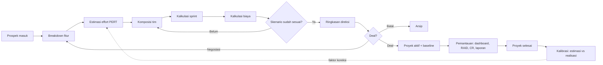

# PRD — PM Workspace

**Website pendukung kerja Project Manager: estimasi pra-proyek hingga pemantauan eksekusi**

| Atribut | Keterangan |
|---|---|
| Versi dokumen | 0.4 |
| Tanggal | 26 November 2026 |
| Pemilik produk | Project Manager (pengguna tunggal) |
| Status | Fase 1–2 berjalan di lokal (belum dideploy). Status per fitur di Bagian 14. |

**Riwayat perubahan**

| Versi | Perubahan |
|---|---|
| 0.1 | Draft awal. |
| 0.2 | Q2 diputuskan: estimasi dapat diinput dalam story point atau jam, dengan konversi sebagai parameter (default 1 jam = 2 SP). Diperbarui di F1, F4, F5, Bagian 7, 8, 11, 13, dan glosarium. |
| 0.3 | Disesuaikan dengan sistem yang berjalan: Q1, Q3, Q5 diputuskan; kriteria penerimaan yang sudah terpenuhi dicentang; model data diperbarui; tambahan di luar draf (kalender libur, draf AI, Gantt, aktivitas proyek, status manual) dan keputusan desain F10–F14 dicatat di Bagian 14. |
| 0.4 | Badan F10 diselaraskan dengan aturan yang berjalan (14.1). Aturan privasi draf AI ditambahkan di F4, Bagian 9, dan 14.2. Status validasi MVP ditambahkan di Bagian 12. Rencana berikutnya (14.3) diurutkan ulang: backup lokal dan privasi AI didahulukan. |

---

## 1. Latar Belakang

Sebagai Project Manager software development, informasi yang dibutuhkan untuk mengambil keputusan tersebar di banyak tempat: spreadsheet estimasi, Jira/Linear, catatan rapat, chat, dan ingatan pribadi. Akibatnya:

1. **Estimasi pra-proyek tidak konsisten.** Setiap calon proyek dihitung ulang dari nol, dengan asumsi yang berbeda-beda dan tanpa jejak alasan di balik angka.
2. **Angka yang dijanjikan ke direksi sulit dipertahankan.** Estimasi sering disajikan sebagai satu angka pasti, padahal penuh ketidakpastian.
3. **Tidak ada pembelajaran dari proyek sebelumnya.** Selisih antara estimasi dan realisasi tidak pernah dicatat secara sistematis, sehingga kesalahan yang sama terulang.
4. **Kondisi proyek berjalan sulit dilihat secara ringkas.** Risiko, keputusan, dan perubahan scope tercecer.

PM Workspace dibangun untuk menyatukan seluruh siklus hidup proyek, mulai dari **prospek → estimasi → proposal → deal → eksekusi → evaluasi**, dalam satu tempat, dengan output yang layak dipresentasikan ke direksi.

## 2. Tujuan dan Metrik Keberhasilan

### 2.1 Tujuan

| ID | Tujuan |
|---|---|
| G1 | Menyusun estimasi MP, sprint, dan biaya calon proyek secara terstruktur dan dapat diulang. |
| G2 | Menghasilkan ringkasan estimasi yang siap dipresentasikan ke direksi. |
| G3 | Menjadikan estimasi yang disepakati sebagai baseline proyek saat deal. |
| G4 | Memantau kesehatan proyek berjalan (progres, risiko, keputusan, perubahan scope). |
| G5 | Meningkatkan akurasi estimasi dari waktu ke waktu melalui kalibrasi data historis. |

### 2.2 Metrik Keberhasilan

| Metrik | Target |
|---|---|
| Waktu menyusun estimasi calon proyek baru | ≤ 2 jam (dari sebelumnya ± 1 hari) |
| Waktu menyiapkan materi estimasi untuk direksi | ≤ 15 menit setelah estimasi final |
| Selisih estimasi vs realisasi durasi (setelah ≥ 3 proyek terkalibrasi) | ≤ 20% |
| Waktu menyusun laporan status mingguan | ≤ 15 menit |
| Pemakaian | Dipakai pada 100% calon proyek baru sejak MVP rilis |

## 3. Pengguna

| Peran | Akses | Kebutuhan |
|---|---|---|
| **Project Manager (pengguna utama)** | Penuh | Menyusun estimasi, mengelola proyek, membuat laporan. |
| **Direksi (audiens output)** | Tidak login; menerima hasil ekspor (PDF/tautan baca-saja) | Melihat ringkasan durasi, biaya, tim, asumsi, dan risiko dengan cepat. |

Sistem dirancang untuk **satu pengguna**. Multi-user bukan bagian dari cakupan versi ini (lihat Bagian 4.3).

## 4. Ruang Lingkup

### 4.1 Fase 1 — MVP: Estimasi Pra-Proyek

| ID | Fitur |
|---|---|
| F1 | Master data (peran, rate, parameter default) |
| F2 | Pipeline prospek |
| F3 | Library fitur (template estimasi) |
| F4 | Breakdown dan estimasi fitur (PERT) |
| F5 | Komposisi tim dan kalkulasi sprint |
| F6 | Kalkulasi biaya dan harga |
| F7 | Skenario dan versi estimasi |
| F8 | Ringkasan untuk direksi (ekspor) |
| F9 | Konversi prospek menjadi proyek (baseline) |

### 4.2 Fase 2 — Eksekusi Proyek

| ID | Fitur |
|---|---|
| F10 | Dashboard kesehatan proyek |
| F11 | RAID log (Risks, Assumptions, Issues, Dependencies) |
| F12 | Decision log |
| F13 | Change request |
| F14 | Laporan status mingguan |

### 4.3 Fase 3 — Pembelajaran dan Integrasi

| ID | Fitur |
|---|---|
| F15 | Kalibrasi historis (estimasi vs realisasi) |
| F16 | Integrasi Jira/Linear, Google Calendar, Slack |

### 4.4 Di Luar Cakupan

- Multi-user, kolaborasi tim, dan hak akses per peran.
- Pengganti Jira/Linear (manajemen tiket penuh).
- Penagihan (invoicing), akuntansi, dan penggajian.
- Time tracking harian per individu.

## 5. Alur Besar Sistem



### 5.1 Status Prospek

| Status | Arti |
|---|---|
| `Prospek` | Calon proyek baru dicatat, belum diestimasi. |
| `Estimasi` | Sedang disusun breakdown dan perhitungannya. |
| `Proposal Dikirim` | Ringkasan sudah dipresentasikan atau dikirim. |
| `Negosiasi` | Ada permintaan revisi scope, waktu, atau harga. |
| `Deal` | Disepakati; otomatis dikonversi menjadi proyek. |
| `Batal` | Tidak dilanjutkan; data tetap disimpan beserta alasannya. |

---

## 6. Spesifikasi Fitur

Setiap fitur ditulis dengan format: tujuan, user story, data, aturan bisnis, dan kriteria penerimaan.

### F1 — Master Data

**Tujuan:** Menyimpan parameter yang dipakai berulang agar setiap estimasi memakai dasar yang sama.

**User story:** Sebagai PM, saya ingin mengatur rate dan parameter default sekali saja, agar tidak mengisi ulang di setiap estimasi.

**Data:**

| Kelompok | Field |
|---|---|
| Peran | Nama peran (UI/UX, Frontend, Backend, Mobile, QA, DevOps, PM, dll.), level (Junior/Mid/Senior), sumber (Internal/Vendor), aktif/nonaktif |
| Rate card | Peran, level, sumber, rate bulanan (Rp), tanggal berlaku |
| Parameter default | Satuan input estimasi (Story Point/Jam), konversi story point per jam, panjang sprint (minggu), hari kerja per sprint, jam efektif per hari, focus factor, jumlah sprint stabilisasi/UAT, persentase contingency, persentase markup, konversi minggu → bulan |

**Nilai default awal (dapat diubah):**

| Parameter | Default |
|---|---|
| Satuan input estimasi | Story Point |
| Konversi | 1 jam = 2 SP (1 SP = 0,5 jam) |
| Panjang sprint | 2 minggu |
| Hari kerja per sprint | 10 hari |
| Jam efektif per hari | 6 jam |
| Focus factor | 0,8 |
| Sprint stabilisasi/UAT | 1 sprint |
| Contingency | 15% |
| Markup | 30% |
| Konversi bulan | 4 minggu = 1 bulan |

**Aturan bisnis:**
- Rate card memiliki **tanggal berlaku**. Estimasi menyimpan salinan (snapshot) rate yang dipakai saat dibuat, sehingga perubahan rate di kemudian hari tidak mengubah estimasi lama.
- Peran yang dinonaktifkan tidak muncul di estimasi baru, tetapi tetap tampil pada estimasi lama.

**Kriteria penerimaan:**
- [x] PM dapat menambah, mengubah, dan menonaktifkan peran serta rate.
- [x] Mengubah rate tidak mengubah angka pada estimasi yang sudah tersimpan.
- [x] Parameter default otomatis terisi saat membuat estimasi baru dan bisa diubah per estimasi.

### F2 — Pipeline Prospek

**Tujuan:** Mencatat semua calon proyek dan statusnya dalam satu daftar.

**User story:** Sebagai PM, saya ingin melihat semua calon proyek beserta statusnya, agar tahu mana yang perlu segera diestimasi atau ditindaklanjuti.

**Data:** nama prospek, klien/unit bisnis, kontak, ringkasan kebutuhan, tujuan bisnis, tenggat yang diminta, batas anggaran (opsional), status, tanggal dibuat, catatan, alasan batal (jika batal).

**Aturan bisnis:**
- Perubahan status tercatat di riwayat (status lama, status baru, tanggal).
- Status `Batal` wajib disertai alasan.
- Status `Deal` hanya bisa dipilih jika ada satu versi estimasi yang ditandai **final** (lihat F7).

**Kriteria penerimaan:**
- [x] Tampilan daftar dan tampilan kanban per status.
- [x] Filter berdasarkan status dan klien; pencarian berdasarkan nama.
- [x] Riwayat perubahan status dapat dilihat per prospek.

### F3 — Library Fitur

**Tujuan:** Mempercepat estimasi dengan template fitur umum yang sudah memiliki angka default.

**User story:** Sebagai PM, saya ingin memilih fitur umum seperti login atau payment gateway dari library, agar tidak menghitung dari nol setiap kali.

**Data:** nama fitur, kategori (Auth, CRUD, Pembayaran, Notifikasi, Laporan, Integrasi, dll.), deskripsi, tingkat kompleksitas (Rendah/Sedang/Tinggi), estimasi default per peran (O, M, P dalam jam), catatan asumsi.

**Aturan bisnis:**
- Menambahkan fitur dari library ke estimasi akan **menyalin** nilainya. Perubahan di estimasi tidak mengubah library, dan sebaliknya.
- Fitur dalam estimasi dapat disimpan kembali ke library sebagai template baru.
- Setelah F15 aktif, library menampilkan rata-rata realisasi dari proyek sebelumnya sebagai referensi.

**Kriteria penerimaan:**
- [x] PM dapat menambah, mengubah, dan menghapus template fitur.
- [x] PM dapat menambahkan beberapa fitur dari library sekaligus ke dalam estimasi.

### F4 — Breakdown dan Estimasi Fitur (PERT)

**Tujuan:** Menghitung effort per fitur per peran secara realistis, lengkap dengan rentang ketidakpastian.

**User story:** Sebagai PM, saya ingin mengisi estimasi optimis, paling mungkin, dan pesimis untuk setiap fitur, agar hasilnya berupa rentang yang jujur, bukan satu angka tebakan.

**Data per fitur:** nama, deskripsi singkat, prioritas (Must/Should/Could), asumsi, lalu per peran: O (optimis), M (paling mungkin), P (pesimis) dalam satuan input yang dipilih (story point atau jam).

**Aturan bisnis:**
- Effort dihitung dengan rumus PERT (lihat Bagian 7.1).
- Satuan input mengikuti parameter estimasi (default: story point). Semua perhitungan kapasitas dan biaya dilakukan dalam **jam** setelah dikonversi (Bagian 7.0).
- Tampilan menampilkan kedua satuan berdampingan (misalnya "96 SP ≈ 48 jam") agar mudah dibaca tim teknis maupun direksi.
- Konversi disimpan di snapshot estimasi. Mengubah parameter konversi di master data tidak mengubah estimasi lama.
- Validasi: O ≤ M ≤ P. Jika tidak terpenuhi, sistem menampilkan peringatan dan data tidak dapat disimpan.
- Fitur dapat dikelompokkan per modul atau epic.
- Prioritas memungkinkan simulasi "hanya Must-have" pada F7.

**Draf fitur dengan AI (tambahan, lihat 14):**
- Pemanggilan AI hanya dilakukan dari server. API key disimpan di variabel lingkungan dan tidak pernah dikirim ke browser.
- Data yang dikirim dibatasi: nama proyek, kebutuhan, tujuan, catatan, dan nama peran. **Tidak pernah dikirim:** rate, biaya, harga, nama orang, data proyek lain, dan isi RAID/keputusan.
- Sebelum dikirim, PM melihat **pratinjau teks persis** yang akan dikirim dan dapat mengeditnya.
- Opsi **samarkan identitas**: nama klien dan nama proyek diganti penanda (misalnya `[Klien]`, `[Proyek]`) sebelum dikirim, lalu dikembalikan di hasil bila muncul.
- Fitur dapat dimatikan sepenuhnya di Pengaturan. Bila dimatikan atau API key kosong, tombol tidak ditampilkan.
- Hasil AI masuk sebagai fitur berstatus **draf AI** yang wajib ditinjau. Penanda draf hilang setelah PM mengubah atau menyetujui baris tersebut.
- Setiap pemanggilan dicatat: waktu, penyedia, model, jumlah karakter terkirim, dan apakah disamarkan. Isi teks tidak disimpan di log.
- Sebelum memakai penyedia tertentu, periksa kebijakan retensi dan pemakaian data untuk pelatihan model penyedia tersebut.

**Kriteria penerimaan:**
- [x] Total effort per peran dan per fitur ter-update otomatis saat angka diubah.
- [x] Ditampilkan nilai E (estimasi) dan σ (deviasi) per fitur dan total.
- [x] Satuan input dapat diganti per estimasi; angka yang sudah diisi dikonversi otomatis tanpa kehilangan nilai.
- [x] Fitur dapat diduplikasi, diurutkan, dan dihapus.

### F5 — Komposisi Tim dan Kalkulasi Sprint

**Tujuan:** Menentukan jumlah MP per peran dan menghitung jumlah sprint yang dibutuhkan.

**User story:** Sebagai PM, saya ingin mengatur jumlah orang per peran dan langsung melihat jumlah sprint serta peran mana yang menjadi bottleneck.

**Data per peran:** jumlah MP (boleh desimal, misalnya 0,5 untuk paruh waktu), level, sumber (Internal/Vendor), durasi keterlibatan (default: sepanjang proyek; dapat diubah, misalnya UI/UX hanya di awal).

**Aturan bisnis:**
- Kapasitas dan jumlah sprint dihitung sesuai Bagian 7.2.
- **Bottleneck** adalah peran dengan jumlah sprint terbesar. Peran ini disorot di tampilan.
- Peran yang memiliki effort tetapi MP = 0 memunculkan peringatan.
- Peran pengelolaan (PM) tidak dihitung dari effort fitur, melainkan sebagai alokasi persentase sepanjang proyek.

**Kriteria penerimaan:**
- [x] Tabel per peran menampilkan: effort (SP dan jam), MP, kapasitas per sprint (SP dan jam), dan sprint dibutuhkan.
- [x] Total sprint dan durasi (minggu dan bulan) tampil otomatis.
- [x] Peran bottleneck tersorot secara visual.

### F6 — Kalkulasi Biaya dan Harga

**Tujuan:** Menghitung total biaya proyek dan harga yang diajukan.

**User story:** Sebagai PM, saya ingin melihat rincian biaya per peran hingga harga jual, agar bisa menjelaskan dari mana angka berasal.

**Data:** biaya SDM per peran (otomatis dari F5 dan rate card), biaya overhead (infrastruktur/server, lisensi, perjalanan, lain-lain; input manual), persentase contingency, persentase markup.

**Aturan bisnis:**
- Rumus sesuai Bagian 7.3.
- Semua nominal dalam Rupiah, format `Rp1.234.567`.
- Sistem membedakan **markup** (persentase di atas biaya) dan **margin** (persentase dari harga jual), serta menampilkan keduanya agar tidak terjadi salah paham saat negosiasi.

**Kriteria penerimaan:**
- [x] Rincian biaya per peran, overhead, subtotal, contingency, total biaya, dan harga jual tampil berurutan.
- [x] Mengubah MP, rate, atau parameter langsung memperbarui seluruh angka.
- [x] Ditampilkan rentang biaya bawah dan atas (Bagian 7.4).

### F7 — Skenario dan Versi Estimasi

**Tujuan:** Membandingkan beberapa opsi dan menjaga riwayat perubahan selama negosiasi.

**User story:** Sebagai PM, saya ingin membandingkan opsi "tim kecil, lebih lama" dengan "tim besar, lebih cepat", dan menyimpan setiap revisi selama negosiasi.

**Aturan bisnis:**
- Satu prospek dapat memiliki banyak **versi** estimasi (v1, v2, ...). Setiap versi menyimpan snapshot fitur, tim, rate, dan parameter.
- Dalam satu versi dapat dibuat beberapa **skenario** (misalnya A: 2 BE, B: 3 BE, C: hanya Must-have).
- Hanya satu versi yang dapat ditandai **final**. Versi final terkunci dan tidak dapat diubah; revisi dilakukan dengan membuat versi baru.
- Saat skenario menambah MP, sistem menampilkan pengingat bahwa penambahan orang tidak mempercepat secara linear (onboarding dan biaya koordinasi). Faktor overhead koordinasi bersifat opsional dan dapat diatur.

**Kriteria penerimaan:**
- [x] Tabel perbandingan skenario berdampingan: MP total, sprint, durasi, total biaya, dan harga jual.
- [x] Perbandingan antarversi menampilkan apa yang berubah (fitur ditambah/dihapus, selisih angka).

### F8 — Ringkasan untuk Direksi

**Tujuan:** Menghasilkan materi satu halaman yang siap dipresentasikan.

**User story:** Sebagai PM, saya ingin mengekspor ringkasan estimasi ke PDF, agar bisa langsung dibawa ke rapat direksi tanpa menyusun ulang.

**Isi ringkasan:**
1. Nama proyek, klien, tanggal, dan versi estimasi.
2. Ringkasan scope (daftar modul/fitur utama).
3. **Durasi**: rentang dan nilai paling mungkin (contoh: "5–7 sprint, paling mungkin 6 sprint ≈ 3 bulan").
4. **Biaya dan harga**: rentang dan nilai paling mungkin.
5. Komposisi tim.
6. Perbandingan skenario (jika ada lebih dari satu).
7. Asumsi utama.
8. Hal yang tidak termasuk (exclusions).
9. Tiga risiko teratas.
10. Akurasi historis (setelah F15 aktif), misalnya "rata-rata selisih estimasi 3 proyek terakhir: 12%".

**Aturan bisnis:**
- Rincian rate per peran **dapat disembunyikan** pada ekspor, karena tidak semua audiens perlu melihat rate individual.
- Bahasa dan istilah di ringkasan menggunakan bahasa bisnis, bukan istilah teknis (misalnya "bulan", bukan hanya "sprint").

**Kriteria penerimaan:**
- [x] Ekspor PDF berukuran A4 dengan tata letak rapi.
- [ ] Opsi tautan baca-saja (Fase 2, opsional).
- [x] Opsi menampilkan atau menyembunyikan rincian rate.

### F9 — Konversi Prospek Menjadi Proyek

**Tujuan:** Menjadikan estimasi final sebagai baseline proyek tanpa input ulang.

**User story:** Sebagai PM, ketika prospek deal, saya ingin estimasi final otomatis menjadi rencana awal proyek.

**Aturan bisnis:**
- Saat status berubah menjadi `Deal`, sistem membuat entitas **Proyek** dengan baseline: daftar fitur, effort, komposisi tim, jumlah sprint, biaya, dan tanggal mulai (input PM).
- Rencana sprint awal dibuat otomatis berdasarkan total sprint dan tanggal mulai.
- Asumsi dan risiko dari estimasi otomatis masuk ke RAID log (F11).
- Baseline terkunci. Perubahan scope setelah deal hanya melalui Change Request (F13).

**Kriteria penerimaan:**
- [x] Proyek baru muncul dengan data baseline lengkap.
- [x] Tautan dua arah antara proyek dan prospek/estimasi asalnya.

### F10 — Dashboard Kesehatan Proyek (Fase 2)

**Tujuan:** Melihat kondisi semua proyek aktif secara ringkas.

**Isi:** status per proyek (Hijau/Kuning/Merah) beserta alasannya, progres terhadap rencana, sprint berjalan, proyeksi selesai, tenggat terdekat, jumlah risiko tinggi terbuka, blocker aktif, change request menunggu keputusan, dan perubahan scope dari CR. Proyek yang paling bermasalah tampil di atas.

**Aturan bisnis (berjalan, ambang tetap):**

| Status | Kondisi (salah satu terpenuhi) |
|---|---|
| Merah | Proyeksi selesai mundur > 20% dari durasi rencana, atau ada risiko tinggi tanpa mitigasi |
| Kuning | Mundur 10–20%, ada fitur/aktivitas terlambat, progres > 15 poin di bawah rencana hari ini, atau ada blocker > 2 hari |
| Hijau | Tidak ada kondisi di atas |

- Durasi rencana mengikuti **target selesai** (baseline + sprint dari CR yang disetujui), sehingga tambahan scope yang disetujui tidak dihitung sebagai keterlambatan.
- **Blocker** = item RAID bertipe Isu yang belum selesai.
- Setiap status Kuning/Merah menampilkan **alasan** yang memicunya.
- PM dapat menetapkan status manual dengan alasan wajib; tampil sebagai "Ditetapkan PM: …" dan dapat dikembalikan ke otomatis.
- Rincian keputusan desain ada di 14.1.

**Direncanakan (belum berjalan):**
- Kondisi biaya: Merah bila realisasi biaya > 110% anggaran, Kuning bila 100–110%. Membutuhkan pencatatan biaya aktual.
- Ambang status dapat diubah di Pengaturan.

### F11 — RAID Log (Fase 2)

**Data:** tipe (Risk/Assumption/Issue/Dependency), deskripsi, pemilik, dampak (1–5), kemungkinan (1–5, khusus Risk), skor (dampak × kemungkinan), rencana mitigasi/tindakan, tanggal tinjau ulang, status (Terbuka/Dipantau/Selesai).

**Aturan bisnis:**
- Risiko dengan skor ≥ 15 dikategorikan tinggi dan muncul di dashboard.
- Item yang melewati tanggal tinjau ulang ditandai.
- Matriks risiko (dampak × kemungkinan) ditampilkan secara visual.

### F12 — Decision Log (Fase 2)

**Data:** tanggal, keputusan, pengambil keputusan, alasan, alternatif yang dipertimbangkan, dampak, tautan ke dokumen atau rapat terkait.

**Aturan bisnis:** keputusan tidak dihapus. Jika dibatalkan, buat keputusan baru yang merujuk keputusan lama.

### F13 — Change Request (Fase 2)

**Data:** deskripsi perubahan, peminta, tanggal, alasan, dampak terhadap effort (dihitung dengan mekanisme F4), dampak terhadap sprint dan biaya (otomatis), status (Diajukan/Disetujui/Ditolak), penyetuju, tanggal keputusan.

**Aturan bisnis:**
- CR yang disetujui memperbarui **rencana saat ini**, tetapi baseline asli tetap disimpan untuk perbandingan.
- Dashboard menampilkan akumulasi perubahan scope sejak baseline (misalnya "+18% effort dari baseline").

### F14 — Laporan Status Mingguan (Fase 2)

**Tujuan:** Membuat laporan mingguan dalam ≤ 15 menit.

**Aturan bisnis:**
- Draf laporan terisi otomatis dari dashboard, RAID, decision log, dan CR minggu berjalan.
- PM menambahkan narasi: pencapaian, kendala, rencana minggu depan, dan bantuan yang dibutuhkan.
- Dua template: **Direksi** (ringkas, fokus waktu, biaya, risiko) dan **Teknis** (lebih detail).
- Laporan yang sudah dikirim diarsipkan dan tidak dapat diubah.

### F15 — Kalibrasi Historis (Fase 3)

**Tujuan:** Meningkatkan akurasi estimasi berdasarkan rekam jejak sendiri.

**Aturan bisnis:**
- Saat proyek ditutup, PM mengisi realisasi effort per peran (atau ditarik dari integrasi F16).
- Sistem menghitung **faktor kalibrasi** per peran dan per kategori fitur (Bagian 7.5).
- Faktor kalibrasi disarankan secara otomatis pada estimasi baru. PM dapat menerima atau mengabaikannya.
- Faktor kalibrasi baru dianggap cukup andal setelah minimal **3 proyek** selesai.

### F16 — Integrasi (Fase 3)

| Integrasi | Kegunaan |
|---|---|
| Jira / Linear | Menarik progres sprint, velocity, dan realisasi effort |
| Google Calendar | Menarik jadwal rapat dan cuti tim |
| Slack | Mengirim pengingat (tanggal tinjau risiko, CR menunggu keputusan) |

---

## 7. Rumus Perhitungan

### 7.0 Konversi Satuan

```
SP_per_jam    = parameter konversi            (default 2)
Jam           = SP / SP_per_jam
SP            = Jam × SP_per_jam
```

Jika satuan input adalah story point, nilai O, M, P dikonversi ke jam sebelum masuk rumus 7.2 dan 7.3. Rumus PERT (7.1) dapat dihitung di satuan mana pun karena bersifat linear.

### 7.1 Estimasi Effort (PERT)

Untuk setiap fitur dan peran:

```
E = (O + 4M + P) / 6        → estimasi effort (jam)
σ = (P − O) / 6             → deviasi standar (jam)
```

Total per peran:

```
Effort_peran = Σ E_fitur × faktor_kalibrasi_peran     (default faktor = 1,0)
σ_total      = √( Σ σ_fitur² )
```

### 7.2 Kapasitas dan Sprint

```
Kapasitas per orang per sprint = hari_kerja_per_sprint × jam_efektif_per_hari × focus_factor
Kapasitas peran per sprint     = MP_peran × kapasitas_per_orang
Sprint_peran                   = Effort_peran / Kapasitas_peran
Sprint pengembangan            = ROUNDUP( MAX(Sprint_peran) )
Total sprint                   = Sprint pengembangan + sprint_stabilisasi
Durasi (minggu)                = Total sprint × panjang_sprint
Durasi (bulan)                 = Durasi (minggu) / konversi_minggu_per_bulan
```

### 7.3 Biaya dan Harga

```
Biaya_peran      = MP_peran × rate_bulanan_peran × bulan_keterlibatan_peran
Biaya SDM        = Σ Biaya_peran + Biaya PM (alokasi % × rate × durasi)
Subtotal         = Biaya SDM + Overhead
Contingency      = Subtotal × %contingency
Total biaya      = Subtotal + Contingency
Harga jual       = Total biaya × (1 + %markup)
Margin (info)    = (Harga jual − Total biaya) / Harga jual
```

### 7.4 Rentang untuk Direksi

```
Effort bawah = Σ E − σ_total
Effort atas  = Σ E + σ_total
```

Rentang effort dikonversi menjadi rentang sprint dan biaya dengan rumus 7.2 dan 7.3. Lebar rentang (±1σ, ±1,5σ, dst.) dapat diatur di parameter.

### 7.5 Faktor Kalibrasi

```
Faktor_kalibrasi_peran = rata-rata( Realisasi_effort / Estimasi_effort ) dari N proyek terakhir
```

Contoh: estimasi backend 400 jam, realisasi 480 jam → rasio 1,2. Jika rata-rata 3 proyek = 1,2, estimasi backend berikutnya disarankan dikali 1,2.

### 7.6 Contoh Perhitungan Lengkap

**Parameter:** sprint 2 minggu, 10 hari kerja, 6 jam efektif, focus factor 0,8 → **48 jam/orang/sprint = 96 SP/orang/sprint** (konversi 1 jam = 2 SP). Rate di bawah adalah ilustrasi.

Contoh: Backend diinput 960 SP → 960 / 2 = 480 jam.

**Kalkulasi sprint:**

| Peran | Effort | MP | Kapasitas/sprint | Sprint |
|---|---|---|---|---|
| Backend | 480 jam | 2 | 96 jam | **5,0** (bottleneck) |
| Frontend | 360 jam | 2 | 96 jam | 3,75 |
| QA | 200 jam | 1 | 48 jam | 4,17 |
| UI/UX | 120 jam | 1 | 48 jam | 2,5 |

Sprint pengembangan = 5, ditambah 1 sprint stabilisasi = **6 sprint = 12 minggu = 3 bulan**.

**Kalkulasi biaya:**

| Komponen | Perhitungan | Jumlah |
|---|---|---|
| Backend | 2 × Rp15.000.000 × 3 bln | Rp90.000.000 |
| Frontend | 2 × Rp13.000.000 × 3 bln | Rp78.000.000 |
| QA | 1 × Rp10.000.000 × 3 bln | Rp30.000.000 |
| UI/UX | 1 × Rp12.000.000 × 1,5 bln | Rp18.000.000 |
| PM (50%) | 0,5 × Rp18.000.000 × 3 bln | Rp27.000.000 |
| Overhead | — | Rp0 |
| **Subtotal** | | **Rp243.000.000** |
| Contingency 15% | | Rp36.450.000 |
| **Total biaya** | | **Rp279.450.000** |
| **Harga jual** (markup 30%) | | **Rp363.285.000** |
| Margin (info) | (363.285.000 − 279.450.000) / 363.285.000 | ≈ 23,1% |

> Catatan: markup 30% setara margin ± 23%. Perbedaan ini sengaja ditampilkan agar tidak terjadi salah tafsir saat negosiasi dengan direksi atau klien.

---

## 8. Model Data

| Entitas | Field utama | Relasi |
|---|---|---|
| `Role` | id, nama, level, sumber, aktif | — |
| `RateCard` | id, role_id, rate_bulanan, berlaku_mulai | → Role |
| `Settings` | parameter default (Bagian F1), termasuk satuan input dan SP_per_jam | — |
| `Holiday` | tanggal, nama, jenis (libur nasional / cuti bersama) | — (disalin ke estimasi sebagai snapshot) |
| `FeatureTemplate` | id, nama, kategori, kompleksitas, deskripsi, asumsi | 1–n `FeatureTemplateEffort` |
| `FeatureTemplateEffort` | template_id, role_id, O, M, P | → FeatureTemplate, Role |
| `Prospect` | id, nama, klien, kebutuhan, tenggat, budget, status | 1–n Estimate, 1–n StatusHistory |
| `StatusHistory` | prospect_id, dari, ke, tanggal, catatan | → Prospect |
| `Estimate` | id, prospect_id, versi, is_final, snapshot_settings, snapshot_rates, snapshot_holidays, rencana_mulai, asumsi, exclusions, risiko | 1–n Scenario, 1–n EstimateFeature |
| `EstimateFeature` | id, estimate_id, nama, modul, prioritas, asumsi | 1–n EstimateEffort |
| `EstimateEffort` | feature_id, role_id, O, M, P | → EstimateFeature, Role |
| `Scenario` | id, estimate_id, nama, filter_prioritas, overhead_items | 1–n ScenarioTeam |
| `ScenarioTeam` | scenario_id, role_id, mp, bulan_keterlibatan | → Scenario, Role |
| `Project` | id, prospect_id, estimate_id_baseline, scenario_id_baseline, tanggal_mulai, baseline (JSON beku), status, status_kesehatan_manual, alasan | 1–n Sprint, ProjectFeature, ProjectActivity, RaidItem, Decision, ChangeRequest, StatusReport |
| `ProjectFeature` | project_id, feature_id **atau** change_request_id, sprint baseline mulai/selesai, sprint rencana mulai/selesai, progres % | → Project, EstimateFeature / ChangeRequest |
| `ProjectActivity` | project_id, nama, jenis (aktivitas/milestone), tanggal mulai/selesai, selesai, sprint_number | → Project |
| `Sprint` | project_id, nomor, tanggal mulai/selesai, rencana, realisasi | → Project |
| `RaidItem` | project_id, tipe, deskripsi, pemilik, dampak, kemungkinan, mitigasi, tgl_tinjau, status | → Project |
| `Decision` | project_id, nomor, tanggal, keputusan, pengambil, alasan, alternatif, dampak, tautan, membatalkan_id | → Project, Decision (yang dibatalkan) |
| `ChangeRequest` | project_id, nomor, judul, deskripsi, peminta, tanggal, alasan, effort O/M/P per peran, status, penyetuju, tanggal keputusan, dampak beku (effort, sprint, biaya, harga) | → Project |
| `StatusReport` | project_id, periode (Senin–Minggu), narasi (pencapaian, kendala, rencana, bantuan), snapshot data saat terkirim, tanggal kirim | → Project |
| `Actual` | project_id, role_id, kategori_fitur, effort_realisasi *(belum dibuat, F15)* | → Project, Role |

**Prinsip penting:** estimasi menyimpan **snapshot**, bukan referensi hidup, untuk rate dan parameter. Angka yang pernah dipresentasikan ke direksi tidak boleh berubah diam-diam.

## 9. Kebutuhan Non-Fungsional

| Aspek | Kebutuhan |
|---|---|
| Autentikasi | Login satu pengguna dengan password kuat; opsional 2FA. |
| Keamanan data | Data rate dan biaya bersifat sensitif: HTTPS wajib, database tidak terbuka ke publik. |
| Backup | Backup otomatis harian; ekspor seluruh data ke JSON/CSV kapan saja. |
| Performa | Perhitungan ulang estimasi terasa instan (< 300 ms) untuk ≤ 200 fitur. |
| Tampilan | Responsif; optimal di desktop, tetap dapat dibaca di tablet/ponsel. |
| Bahasa dan format | Antarmuka bahasa Indonesia; format Rupiah dan tanggal Indonesia (26 Nov 2026). |
| Audit | Perubahan status, finalisasi estimasi, dan keputusan CR tercatat beserta waktunya. |
| Ekspor | PDF untuk ringkasan direksi dan laporan; CSV/XLSX untuk tabel estimasi. |
| Privasi AI | Data ke penyedia AI dibatasi, dapat dipratinjau dan disamarkan, fitur dapat dimatikan; rincian di F4. |

## 10. Rencana Rilis

| Fase | Cakupan | Hasil yang dapat dipakai |
|---|---|---|
| **Fase 1 — MVP** | F1–F9 | Estimasi pra-proyek lengkap hingga ringkasan direksi dan konversi ke proyek. |
| **Fase 2** | F10–F14 | Pemantauan proyek berjalan dan laporan mingguan. |
| **Fase 3** | F15–F16 | Kalibrasi historis dan integrasi alat eksternal. |

**Urutan pengerjaan Fase 1 yang disarankan:** F1 → F4 → F5 → F6 (inti kalkulator) → F3 → F7 → F8 → F2 → F9. Kalkulator inti dibangun lebih dulu karena paling cepat memberi nilai dan dapat langsung diuji dengan data proyek lama.

## 11. Risiko dan Asumsi Produk

| Tipe | Deskripsi | Mitigasi |
|---|---|---|
| Risiko | Estimasi tetap meleset karena input awal kurang akurat. | Rentang PERT, contingency, dan kalibrasi historis (F15). |
| Risiko | Website tidak dipakai rutin karena input terasa berat. | Library fitur (F3), nilai default, dan fokus MVP yang sempit. |
| Risiko | Direksi menganggap nilai "paling mungkin" sebagai janji pasti. | Ringkasan selalu menampilkan rentang dan asumsi secara eksplisit. |
| Asumsi | Rasio story point ke jam relatif stabil dalam satu proyek. | Rasio dijadikan parameter per estimasi; dievaluasi lewat kalibrasi historis (F15). |
| Asumsi | Rate bulanan per peran sudah diketahui atau dapat diperkirakan. | Rate card dengan tanggal berlaku. |

## 12. Validasi MVP

Sebelum dianggap selesai, MVP diuji dengan **2–3 proyek lama** yang realisasinya sudah diketahui:

1. Masukkan scope proyek lama ke kalkulator seolah-olah sebagai prospek baru.
2. Bandingkan hasil estimasi dengan realisasi sebenarnya.
3. Sesuaikan parameter default (focus factor, contingency) jika selisihnya konsisten.

**Status (v0.4):** ⬜ belum tercatat. Hasil validasi dicatat di sini per proyek uji:

| Proyek uji | Estimasi durasi | Realisasi durasi | Selisih | Estimasi biaya | Realisasi biaya | Selisih | Catatan |
|---|---|---|---|---|---|---|---|
| — | — | — | — | — | — | — | — |

## 13. Pertanyaan Terbuka

| ID | Pertanyaan | Dampak |
|---|---|---|
| Q1 | Tech stack dan hosting apa yang akan dipakai? **Tech stack diputuskan (v0.3):** SvelteKit + SQLite sesuai `tech-stack.md`, sudah berjalan di lokal. Hosting (spesifikasi VPS, domain, backup) belum diputuskan. | Arsitektur, biaya operasional |
| ~~Q2~~ | ~~Satuan jam atau story point?~~ **Diputuskan (v0.2):** input dapat berupa story point atau jam; konversi berupa parameter, default 1 jam = 2 SP. | F4, F5, F15 |
| ~~Q3~~ | ~~CTC atau rate jual?~~ **Diputuskan (v0.3):** rate adalah biaya perusahaan (gaji karyawan); harga jual = biaya + contingency + markup. | F6, F8 |
| Q4 | Apakah perlu dukungan mata uang selain Rupiah? | F6, F8 |
| ~~Q5~~ | ~~Fixed price dan time & material?~~ **Diputuskan (v0.3):** harga utama fixed price; time & material ditampilkan sebagai sudut pandang kedua (total T&M dan rate bulanan tim) di samping fixed price. | F6 |
| Q6 | Apakah ringkasan direksi cukup PDF, atau perlu format slide? | F8 |
| Q7 | Apakah UI/UX dan peran lain bisa mulai lebih awal (sprint 0) dan dihitung terpisah dari jalur kritis? | F5 |

## 14. Status Implementasi (per 26 Nov 2026)

Sistem berjalan di lokal (SvelteKit + SQLite), belum dideploy ke server. Tanda: ✅ selesai · 🟡 sebagian · ⬜ belum.

| Fitur | Status | Catatan |
|---|---|---|
| F1 Master data | ✅ | Peran, rate card bertanggal, parameter default. **Tambahan:** master kalender libur (libur nasional dan cuti bersama), terisi dari SKB resmi 2026–2027 dan dapat diubah; memengaruhi kapasitas sprint dan tanggal pada estimasi serta proyek. |
| F2 Pipeline prospek | ✅ | Daftar dan kanban, filter status/klien, pencarian, riwayat status. Prospek dapat dihapus. |
| F3 Library fitur | ✅ | Template dengan effort default per peran (jam); tambah beberapa sekaligus ke estimasi (disalin, dapat diurungkan); simpan fitur estimasi ke library. Rata-rata realisasi menunggu F15. |
| F4 Estimasi PERT | ✅ | Input SP atau jam (disimpan dalam jam). **Tambahan:** draf fitur dengan AI (API kompatibel OpenAI; yang dikirim hanya nama proyek, kebutuhan, tujuan, catatan, dan nama peran). Kontrol privasi sesuai F4 berjalan: pratinjau teks yang dikirim (dapat diedit), samarkan nama klien/proyek, saklar dan log pemanggilan di Pengaturan, baris "Draf AI" wajib ditinjau sebelum final. |
| F5 Tim dan sprint | ✅ | Bottleneck tersorot, pengingat bahwa penambahan orang tidak linear. **Tambahan:** "Sarankan tim" dan jadwal sprint mengikuti kalender libur. |
| F6 Biaya dan harga | ✅ | Rate = biaya perusahaan (Q3). Tampilan time & material di samping fixed price (Q5). |
| F7 Skenario dan versi | ✅ | Versi, finalisasi, kunci versi final, dan hapus versi. Tab **Skenario** di editor: hingga 5 skenario alternatif (tim berbeda dan/atau hanya Must, Must + Should) dibandingkan berdampingan dengan skenario utama, termasuk selisih sprint, biaya, dan harga; "Pakai tim ini sebagai utama". Skenario utama tetap yang dipakai ringkasan direksi dan baseline proyek. Halaman **Bandingkan versi**: angka berdampingan dengan selisih, fitur ditambah/dihapus/berubah, tim dan rate, parameter, serta asumsi/risiko. Faktor overhead koordinasi tidak dihitung (hanya pengingat). |
| F8 Ringkasan direksi | 🟡 | PDF A4 satu halaman, opsi rincian rate. Untuk estimasi yang menjadi baseline proyek, tanggal memakai tanggal mulai proyek. **Belum:** tautan baca-saja (opsional). |
| F9 Konversi ke proyek | ✅ | Deal (dengan tanggal mulai) membuat proyek, baseline beku, sprint, dan RAID dari asumsi/risiko. **Tambahan:** Gantt aktivitas dan milestone (Kick-off, Sprint N, SIT, UAT, Go-live, dapat ditambah), tabel jadwal dan progres per fitur yang direncanakan otomatis dan dapat digeser. |
| F10 Dashboard kesehatan | 🟡 | Lihat 14.1. **Belum:** realisasi biaya vs anggaran (biaya aktual belum dicatat) dan ambang status yang dapat diubah (saat ini tetap). |
| F11 RAID log | ✅ | Matriks risiko 5×5 yang dapat diklik sebagai filter, skor ≥ 15 = tinggi, penanda lewat tanggal tinjau. |
| F12 Decision log | ✅ | Lihat 14.1. |
| F13 Change request | ✅ | Lihat 14.1. |
| F14 Laporan mingguan | ✅ | Lihat 14.1. |
| F15 Kalibrasi historis | ⬜ | Belum dimulai. |
| F16 Integrasi | ⬜ | Belum dimulai. |

### 14.1 Keputusan desain Fase 2

- **Status kesehatan (F10).**
  - Dihitung otomatis dari jadwal dan RAID.
  - **Merah:** proyeksi selesai mundur > 20% dari durasi rencana, atau ada risiko tinggi tanpa mitigasi.
  - **Kuning:** mundur 10–20%, ada fitur/aktivitas terlambat, progres > 15 poin di bawah rencana hari ini, atau ada blocker > 2 hari.
  - **Blocker** = item RAID bertipe Isu yang belum selesai.
  - Proyeksi selesai memperhitungkan sprint stabilisasi/UAT setelah fitur terakhir, sehingga fitur yang mundur ikut memundurkan akhir proyek.
  - PM dapat menetapkan status manual dengan alasan wajib. Alasan tersebut tampil di dashboard dan laporan sebagai "Ditetapkan PM: …", dan PM dapat mengembalikannya ke otomatis.
- **Dashboard (F10).** Halaman Proyek berisi:
  - ringkasan jumlah Merah/Kuning/Hijau, risiko tinggi, blocker, dan CR menunggu;
  - per proyek: status dan alasan, progres vs rencana, sprint berjalan, proyeksi selesai, tenggat terdekat, dan perubahan scope dari CR.
  - Proyek yang paling bermasalah tampil di atas.
- **Change request (F13).**
  - Effort diisi O/M/P per peran.
  - Dampak effort, sprint, biaya, dan harga dihitung dengan mesin estimasi yang sama (baseline + CR yang sudah disetujui, lalu ditambah CR ini) dan dibekukan saat diputuskan. Keputusan bersifat final.
  - CR yang disetujui masuk jadwal sebagai baris fitur dan menggeser **target selesai** (baseline + sprint CR). Baseline asli tetap disimpan, dan tambahan scope yang disetujui tidak dihitung sebagai keterlambatan.
  - Karena biaya = tim × waktu, CR kecil yang muat di kapasitas sprint yang ada berdampak Rp0.
  - **Belum:** CR pengurangan scope.
- **Decision log (F12).**
  - Penomoran K-1, K-2, ….
  - Isi keputusan dapat diperbaiki, tetapi keputusan tidak dapat dihapus.
  - Pembatalan dilakukan dengan keputusan baru yang merujuk keputusan lama. Satu keputusan hanya dapat dibatalkan sekali.
- **Laporan mingguan (F14).**
  - Periode Senin–Minggu, satu laporan per minggu.
  - Data otomatis: status, progres, aktivitas minggu ini dan depan, keterlambatan, RAID, CR, dan keputusan minggu berjalan. PM menambahkan narasi yang tersimpan otomatis.
  - Saat ditandai terkirim, data dibekukan dan laporan terkunci.
  - Cetak A4 dengan template Direksi (ringkas) atau Teknis (rinci).
- **Aktivitas sprint.** Aktivitas "Sprint N" dicentang otomatis saat semua fitur (termasuk CR) yang dijadwalkan selesai di sprint N mencapai 100%, dan dibatalkan bila progres turun lagi. Sprint tanpa fitur yang berakhir di sana tetap dicentang manual.

- **Ketersediaan tim (tambahan, 27 Nov 2026).**
  - *Estimasi:* parameter cadangan cuti tahunan (default 12 hari/orang/tahun) dan sakit (default 3) mengurangi kapasitas sebesar (cuti + sakit) ÷ 240 hari kerja; rencana lembur (jam/orang/sprint) menambah kapasitas dan biaya. Upah lembur = 1/173 upah bulanan × 1,5 jam pertama dan × 2 jam berikutnya per hari (PP 35/2021). Snapshot estimasi lama tanpa parameter ini dihitung 0, sehingga angkanya tidak berubah.
  - *Proyek berjalan:* cuti, sakit, dan lembur dicatat per peran dengan tanggal dan jumlah orang. Dampak per peran = (orang-hari absen × jam efektif − jam lembur) ÷ kapasitas harian peran; proyeksi selesai bergeser sebesar dampak terbesar (dibulatkan ke hari kerja). Ketidakhadiran peran tanpa effort fitur (mis. PM) tidak menggeser jadwal.

### 14.2 Kebutuhan non-fungsional

| Aspek | Status |
|---|---|
| Autentikasi | ✅ Login satu pengguna (argon2), sesi 30 hari, pembatasan 5 percobaan gagal per 15 menit. ⬜ 2FA. |
| Bahasa dan format | ✅ Antarmuka Indonesia, Rupiah, tanggal Indonesia. |
| Ekspor | ✅ PDF ringkasan direksi dan laporan mingguan. ⬜ CSV/XLSX tabel estimasi. |
| Backup | ⬜ Belum ada backup otomatis maupun ekspor data penuh. **Mendesak:** data sungguhan sudah ada di lokal. |
| Privasi AI | ✅ Data terkirim dibatasi, pratinjau dan samarkan identitas, saklar di Pengaturan, log pemanggilan tanpa isi teks. |
| Keamanan data / HTTPS | ⬜ Bergantung pada deploy (belum). |

### 14.3 Rencana berikutnya

1. **Backup lokal segera**, tidak menunggu deploy: `sqlite3 .backup` harian ke folder yang tersinkron ke cloud, simpan 30 salinan terakhir, lalu uji pemulihan sekali.
2. Validasi MVP dengan 2–3 proyek lama (Bagian 12).
3. Deploy ke VPS (menunggu Q1: spesifikasi, domain); backup beralih ke skema server (`tech-stack.md` Bagian 10).
4. F15 kalibrasi historis, lalu F16 integrasi.

---

## Lampiran A — Glosarium

| Istilah | Arti |
|---|---|
| **MP (Man Power)** | Jumlah orang per peran; boleh desimal untuk paruh waktu. |
| **PERT** | Teknik estimasi tiga titik: optimis, paling mungkin, pesimis. |
| **Story Point (SP)** | Satuan relatif ukuran pekerjaan. Di sistem ini dikonversi ke jam lewat parameter (default 1 jam = 2 SP). |
| **Focus factor** | Persentase jam kerja yang benar-benar dipakai untuk pengerjaan, di luar rapat dan gangguan. |
| **Bottleneck** | Peran yang membutuhkan sprint terbanyak dan menentukan durasi proyek. |
| **Contingency** | Cadangan biaya untuk ketidakpastian. |
| **Markup** | Persentase keuntungan di atas biaya. |
| **Margin** | Persentase keuntungan dari harga jual. |
| **Baseline** | Rencana awal yang disepakati saat deal; acuan perbandingan selama proyek. |
| **RAID** | Risks, Assumptions, Issues, Dependencies. |
| **CR (Change Request)** | Permintaan perubahan scope setelah baseline disepakati. |
